# AppSea executive product specification

## Working definition

AppSea is an opportunity intelligence platform for software builders and coding agents.

It continuously gathers complaint and workaround evidence from approved sources, connects that evidence to software products and competitor groups, identifies recurring unmet needs, ranks possible app opportunities, and produces deep planning packages.

The first release ends at a build-ready plan. It does not generate the final product code.

## The central product correction

The useful idea is broader than a Facebook complaint finder, but the source strategy must be narrower than “every platform.” Broad access to social content is controlled by platform APIs, contracts, review programs, quotas, data licenses, privacy duties, and deletion rules.

The product therefore needs a connector registry, not an unrestricted crawler.

Each connector must declare what it can lawfully and technically do. Missing access must remain visible in the product. The ranking system must account for coverage gaps.

## Product promise

For each opportunity, AppSea should be able to show:

- the recurring software problem
- who experiences it
- which apps or workflows are involved
- how often and how recently it appears
- how severe and costly it seems
- what users currently do to cope
- which competitors and substitutes already exist
- which complaints competitors receive
- what part of the problem remains open
- how strong the evidence is
- how risky the data and platform dependencies are
- what an MVP should and should not contain
- what a coding agent should build, test, and verify

## Primary users

### Founder or venture builder

Uses the leaderboard to select a problem worth deeper validation.

### Product researcher

Reviews complaint clusters, evidence quality, competitor coverage, and report assumptions.

### Product manager or innovation team

Runs a research campaign around a category, existing app, workflow, or user segment.

### Coding agent

Reads structured opportunity, plan, task, schema, and acceptance artifacts through an API, CLI, exported package, or MCP server.

### System operator

Manages source permissions, quotas, skills, model policies, cost limits, retention, and workflow health.

## The product loop

```mermaid
flowchart LR
    A[Research campaign] --> B[Approved connectors]
    B --> C[Raw evidence vault]
    C --> D[Normalize and redact]
    D --> E[Classify complaints]
    E --> F[Resolve apps and users]
    F --> G[Cluster problems]
    G --> H[Map competitors and substitutes]
    H --> I[Generate opportunities]
    I --> J[Score with confidence and risk]
    J --> K[Leaderboard]
    K --> L[Deep research package]
    L --> M[Coding-agent plan package]
    M --> N[Human outcome feedback]
    N --> O[Calibration and skill proposals]
    O --> A
```

## Opportunity lifecycle

| State      | Meaning                                                              | Entry requirement                |
| ---------- | -------------------------------------------------------------------- | -------------------------------- |
| Signal     | A possible recurring problem exists                                  | Minimum evidence threshold       |
| Candidate  | A product-shaped opportunity has been proposed                       | Entity and cluster review passed |
| Researched | Competitors, users, workarounds, and contrary evidence were examined | Research coverage gate passed    |
| Planned    | A complete human and machine planning package exists                 | Planning quality gate passed     |
| Approved   | A human chose the opportunity for delivery                           | Decision record exists           |
| Monitoring | The system keeps the opportunity fresh                               | Refresh policy exists            |
| Archived   | Evidence weakened, access failed, or the opportunity was rejected    | Archive reason recorded          |

## Core product surfaces

### Leaderboard

Ranks opportunities with score, confidence, trend, source coverage, complaint count, unique author count, competitor pressure, risk, and freshness.

### Opportunity workspace

Shows the problem definition, score breakdown, evidence graph, complaints, clusters, app entities, users, competitors, substitutes, disconfirming evidence, proposed solution, reports, and plan versions.

### Research console

Creates research campaigns, controls scope and budget, shows connector eligibility, and monitors workflow runs.

### Source registry

Shows platform access state, credentials, quotas, allowed purposes, retention, deletion duties, health, and owner.

### Skill registry

Shows skill versions, permissions, evaluations, active state, recent failures, proposals, and rollback targets.

### Coding-agent interface

Provides typed tools and resources for searching opportunities, reading evidence, obtaining plans, starting approved workflows, and exporting task packages.

## Recommended market wedge

The initial wedge should be software complaints in sources that are technically and contractually clearer, especially developer communities, public video comments, open social protocols, user-submitted links, and customer-authorized imports.

This wedge creates a useful product before restricted networks are available.

The first strong category can be productivity, creator, developer, or small-business software. These categories have public issue reports, clear workflows, recurring integrations, and reachable users.

## Product differentiation

Existing tools commonly focus on one of these jobs:

- social listening for brands
- feedback analysis for a company’s own customers
- app-store intelligence
- product roadmaps and feature requests
- Reddit or community research
- market and competitor analytics

AppSea should focus on the transition from external complaint evidence to a ranked new-product opportunity and then to a coding-agent planning package.

The defensible assets are:

- a policy-aware evidence graph
- entity and competitor resolution across sources
- a calibrated opportunity ranking model
- a history of accepted and rejected opportunities
- outcome feedback from plans and later builds
- high-quality skill and evaluation libraries
- machine-readable planning packages

## Non-negotiable principles

1. Provenance over persuasive writing
2. Source policy over coverage claims
3. Problems over sentiment alone
4. Unique authors over raw mention volume
5. Disconfirming evidence over one-sided reports
6. Confidence beside every major conclusion
7. Deterministic scoring for fixed snapshots
8. Human approval for material production change
9. Structured outputs for coding agents
10. Cost and source budgets for every research run
11. Privacy minimization from ingestion onward
12. Safe rollback for skills, prompts, models, and scoring versions

## Business-level success measures

- percentage of leaderboard entries with complete provenance
- percentage of generated plans accepted without major structural edits
- time from research campaign to a reviewed opportunity package
- precision of top-ranked opportunities in human review
- false-positive complaint rate
- entity-resolution precision
- competitor coverage recall on reviewed samples
- share of reports containing meaningful contrary evidence
- number of opportunities that progress from researched to approved
- cost per accepted opportunity
- source health and freshness compliance
- rate of skill proposals that improve benchmark results
- rate of automated changes rolled back

## Initial release boundary

The initial release includes:

- multi-source research campaigns
- complaint extraction, clustering, and evidence grading
- app and competitor graph
- opportunity generation and ranking
- website leaderboard and detail pages
- report and plan package generation
- JSON and Markdown exports
- read-oriented coding-agent interface
- controlled skill registry
- source and workflow operations
- Windows and macOS desktop shell after the web workflow is stable

The initial release excludes:

- final app code generation
- automatic product deployment
- autonomous purchasing or account creation
- unsupported social scraping
- private-message monitoring without explicit authorization
- autonomous production dependency installation
- unreviewed production code changes
