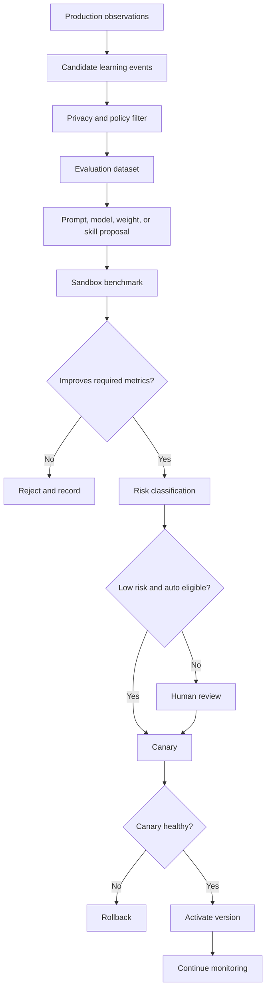

# Autonomy, learning, and self-maintenance

## Product interpretation

“Learn from itself” should mean controlled improvement based on measured outcomes.

It should not mean unrestricted self-modifying production software.

“Operational 24/7” should mean durable workflows, monitoring, repair procedures, and on-call controls. It should not mean that an agent has unlimited authority at all hours.

## Autonomy levels

| Level                 | Capability                                                                | Default approval             |
| --------------------- | ------------------------------------------------------------------------- | ---------------------------- |
| 0 Observe             | Monitor, measure, and report                                              | Automatic                    |
| 1 Recommend           | Propose query, prompt, skill, config, or code changes                     | Automatic proposal           |
| 2 Sandbox             | Apply changes in isolated fixtures and run evaluations                    | Automatic for approved tools |
| 3 Low-risk canary     | Activate narrow low-risk changes under strict rules                       | Policy-controlled            |
| 4 Production change   | Merge code, dependencies, data policy, auth, or infrastructure            | Human approval               |
| 5 External commitment | Purchase, sign agreement, create account, publish, or contact third party | Explicit human action        |

The MVP should support Levels 0 through 2. Level 3 should begin with documentation, query dictionaries, and reversible ranking thresholds only.

## Learning signals

Use these signals:

- complaint classification corrections
- entity mapping corrections
- cluster merge and split decisions
- excluded spam
- opportunity approve or reject decisions
- score-weight changes by profile
- report edits
- plan edits
- evidence later found to be wrong or stale
- research runs that exceeded cost without improving decisions
- coding-agent task failures when later build integration exists
- product outcomes supplied by the user

Track the reason for each correction. A changed output alone does not explain what the system should learn.

## Learning loop

## Skill proposal triggers

A skill proposal can start when:

- repeated failures share a cause
- an agent uses ad hoc steps more than a defined threshold
- a new source type appears
- a schema changes
- a human repeats the same correction
- benchmark coverage is missing
- a new UI pattern is needed
- a runbook is used repeatedly
- a policy change requires a new procedure

The system first searches for an existing skill or update path. It should avoid creating duplicate skills.

## Skill lifecycle

| State      | Meaning                                                |
| ---------- | ------------------------------------------------------ |
| Draft      | Proposed instructions and permissions                  |
| Sandbox    | Runs only on fixtures and isolated data                |
| Evaluated  | Has benchmark results and risk review                  |
| Approved   | Allowed for a defined environment                      |
| Canary     | Limited production traffic                             |
| Active     | Current default version                                |
| Deprecated | Existing runs may finish, new runs use another version |
| Revoked    | Blocked immediately                                    |

## Auto-activation rules

A skill can be auto-activated only when all conditions hold:

- risk level is low
- no new permission is requested
- no new external host is requested
- no package or binary installation is requested
- no schema, auth, billing, retention, or deletion behavior changes
- no production write surface changes
- benchmark improves or remains within defined non-regression limits
- all fixtures pass
- canary limit is enforced
- rollback target exists
- audit event is written

Examples of possible low-risk changes:

- add complaint synonyms to a query dictionary
- improve a report heading order
- add a known app alias after verified review
- adjust a non-material UI label
- add an evaluation fixture
- tune a retry delay inside an approved safe range

## Changes that require human approval

- dependencies
- executable code
- shell commands
- network destinations
- connector activation
- source-policy interpretation
- data-retention rules
- model vendor changes
- secrets and credentials
- authentication
- billing
- user permissions
- production database migrations
- scoring weights used for the default leaderboard
- deployment
- data deletion logic
- desktop signing and update channels

## Skill installation

The system must not install arbitrary skills from the internet.

A skill package needs:

- trusted origin
- content hash
- signature or repository review
- declared permissions
- dependency list
- static scan
- license record
- fixtures
- evaluation result
- owner
- rollback or removal path

Third-party skills run in a sandbox first. Network and filesystem access are denied by default.

## Dependency policy

Dependency proposals must include:

- purpose
- alternatives considered
- maintenance activity
- license
- security history
- transitive dependency impact
- binary or install-script behavior
- size and runtime cost
- removal plan

A lockfile change is reviewed like code.

## Continuous maintenance jobs

### Every few minutes

- API and worker health
- queue depth
- workflow failures
- connector rate-limit state
- critical security alerts

### Hourly

- connector token health
- source freshness
- budget anomalies
- deletion backlog
- failed evidence references

### Daily

- backups and restore verification sampling
- schema validation of recent artifacts
- cost report
- model error sampling
- skill failure report
- stale opportunity detection

### Weekly

- source-policy review queue
- model and prompt drift evaluation
- ranking stability evaluation
- privacy deletion audit
- dependency vulnerability review
- recovery exercise on a non-production environment

### On policy or vendor change

- pause affected path
- assess impact
- update policy version
- run regression tests
- reapprove when needed

## Safe maintenance actions

The maintenance agent may automatically:

- retry idempotent failed work
- pause a failing connector
- reduce concurrency under rate limits
- rotate to an already approved model fallback
- disable a skill with severe errors
- roll back to an approved previous version
- open an incident record
- notify operators
- preserve evidence and audit state

It may not silently broaden permissions or bypass a failing control.

## Cost control

Every workflow and agent action reports cost.

Use:

- per-tenant budgets
- per-campaign budgets
- per-source caps
- model routing
- batch processing
- deduplication before expensive inference
- cached embeddings
- staged deep research only for top candidates
- circuit breakers
- anomaly alerts

A runaway workflow pauses before spending beyond its hard limit.

## Drift detection

Monitor:

- complaint classifier precision
- entity ambiguity
- cluster churn
- score distribution
- top-rank instability
- source mix
- language mix
- model refusal or schema errors
- report citation coverage
- plan acceptance edits

A drift alert creates a diagnostic run. It does not automatically retrain or deploy.

## Rollback

Every active version of these assets needs a rollback target:

- skill
- prompt
- model route
- scoring model
- connector configuration
- schema transformer
- UI feature flag
- desktop update

Rollback should be executable through a typed operation, logged, and tested.

## Kill switches

Provide kill switches for:

- all external collection
- one connector
- all model calls
- one model provider
- skill auto-activation
- all production writes by agents
- MCP write tools
- desktop update channel
- report publication

The emergency state should preserve read access to existing approved artifacts when safe.
