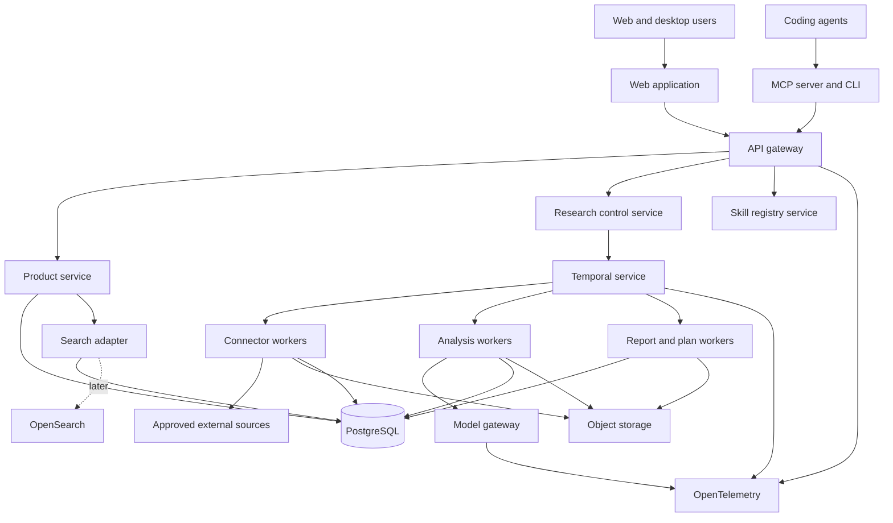

# System architecture

## Architecture goals

- reliable long-running research
- clear service and permission boundaries
- shared contracts for humans and agents
- low operational complexity in the MVP
- a path to larger search and analytics volume
- Windows and macOS support without a second product implementation
- strong provenance, audit, deletion, and cost controls

## Recommended stack

### Application language

Use TypeScript for the primary product, API, workers, contracts, MCP server, CLI, and web UI.

Keep a separate optional Python research-lab package for offline experiments that are not production dependencies.

A mostly single-language system reduces contract drift and improves coding-agent effectiveness.

### Web

- Next.js with server-rendered application routes
- React
- a token-based design system
- accessible component primitives
- server-side table filtering
- Playwright for end-to-end and screenshot checks

### API

- TypeScript service with Fastify, Hono, or a similarly small typed framework
- OpenAPI generation from shared schemas
- OIDC authentication
- tenant-aware authorization middleware

Choose one framework during implementation and record the decision. Do not run two API frameworks.

### Workflow engine

Use Temporal for durable campaign, connector, research, report, and maintenance workflows.

Temporal is valuable here because research may run for minutes or days, pause for review, retry after quotas reset, and resume after worker failure.

### Database

Use PostgreSQL as the system of record.

Recommended extensions and features:

- `pgvector` for initial semantic retrieval
- full-text search for exact and lexical matching
- row-level security as defense in depth
- advisory locks for narrow coordination cases
- transactional outbox
- partitioning later for high-volume evidence tables

### Object storage

Use S3-compatible object storage for permitted raw evidence, imported files, report packages, screenshots, and large workflow artifacts.

Use object versioning and lifecycle rules.

### Cache and rate control

Use Redis for:

- connector rate state
- short-lived cache
- distributed locks only when the workflow engine is not the owner
- session and anti-abuse counters when appropriate

Do not use Redis as the source of truth.

### Search growth path

Start with PostgreSQL full-text search and `pgvector`.

Add OpenSearch when evidence volume, hybrid relevance, faceting, or indexing throughput exceeds the PostgreSQL design envelope.

The search service should be replaceable behind a repository interface.

### Observability

Use OpenTelemetry for traces, metrics, and structured logs.

Route telemetry to a supported backend chosen during deployment.

### Desktop

Use Tauri as a thin desktop shell around the web product and shared UI packages.

### Agent interoperability

Expose an MCP server, REST API, CLI, and package export.

## Logical architecture



## Monorepo shape

```text
apps/
  web/
  api/
  worker/
  mcp/
  cli/
  desktop/
packages/
  contracts/
  db/
  connectors/
  agents/
  skills/
  scoring/
  reports/
  ui/
  auth/
  source-policy/
  observability/
  testing/
infra/
  local/
  cloud/
  monitoring/
docs/
  specs/
  plans/
```

## Service responsibilities

### Web application

- authenticated UI
- leaderboard
- opportunity workspace
- research console
- source and skill registries
- report and plan viewing
- operations dashboard

It does not hold source credentials or run connector logic.

### API gateway and product service

- request authentication
- tenant authorization
- CRUD for campaigns, opportunities, decisions, and settings
- read models for the UI and agents
- export requests
- audit events

### Research control service

- validates campaign configuration
- checks budgets
- starts workflows
- exposes run status
- routes review tasks

### Connector workers

- one connector package per source
- narrow network allowlist
- credential isolation
- cursor and quota handling
- source envelope creation
- deletion and expiry handling

### Analysis workers

- normalization
- prompt-injection isolation
- complaint classification
- entity resolution
- clustering
- competitor research
- evidence grading
- opportunity synthesis
- score-input creation

### Model gateway

- model routing
- structured-output validation
- prompt and model versioning
- redaction
- vendor policy
- rate limits
- cost tracking
- fallback selection
- response logging without sensitive raw content

### Report and plan workers

- deterministic artifact assembly from validated structured data
- Markdown rendering
- JSON package creation
- schema validation
- hash manifest
- object-store publication

### Skill registry service

- skill metadata
- versioning
- permissions
- evaluation records
- activation state
- canary allocation
- rollback

## Connector interface

Each connector implements:

```text
checkEligibility(context)
planQueries(campaign)
collectPage(cursor, budget)
normalizeEnvelope(item)
acknowledgeDeletion(event)
healthCheck()
estimateCost(plan)
```

The interface returns structured policy and quota errors.

## Event model

Use a transactional outbox for database events that must reach workflows or indexing.

Important events:

- campaign.created
- source.connector.enabled
- source.connector.paused
- evidence.collected
- evidence.normalized
- evidence.deleted
- complaint.classified
- entity.linked
- cluster.updated
- opportunity.created
- score.published
- report.published
- plan.published
- decision.recorded
- skill.proposed
- skill.activated
- skill.rolled_back
- policy.changed
- incident.opened

Events carry tenant, actor, correlation, causation, and schema version.

## Multi-tenancy

Use tenant identifiers on all tenant-owned records.

Separate:

- public or licensed shared evidence where contracts permit
- tenant-private evidence
- tenant-specific derived findings
- global product metadata
- global skill and benchmark data

Cross-tenant aggregation needs a defined legal and privacy basis. It should use derived anonymous statistics unless a contract permits more.

## Data flow and immutability

Raw evidence and score snapshots are immutable except for policy-required deletion or expiry.

Derived objects can create new versions.

A report links to immutable inputs. Editing the visible report creates a new version or an annotation, not a hidden mutation.

## Resilience

- workflows retry transient failures with bounded backoff
- permanent policy errors do not retry
- connector cursors commit after durable persistence
- model calls use idempotency keys where supported
- artifact publication uses temporary object names and atomic manifest promotion
- workers can be restarted without losing progress
- source quotas have hard circuit breakers
- partial coverage completes with a warning when allowed

## Scaling path

### Stage 1

- one PostgreSQL cluster
- managed object storage
- managed or self-hosted Temporal
- small Redis
- horizontally scaled workers

### Stage 2

- evidence table partitioning
- read replicas
- separate worker pools by source and model class
- OpenSearch
- dedicated analytics store if needed

### Stage 3

- regional data boundaries
- tenant-specific encryption keys
- licensed data lake partitions
- large-scale event streaming only when the outbox and workflow design no longer suffice

Do not introduce Kafka or Kubernetes only for appearance. Add them when measured load or deployment needs require them.

## Deployment environments

- local development
- automated test
- shared staging with synthetic and licensed test data
- production
- isolated security test environment

Restricted production evidence must not be copied into development.

## Feature flags

Use versioned feature flags for:

- connectors
- model routes
- scoring versions
- skill canaries
- report formats
- MCP write tools
- desktop updates

Flag changes need audit events and rollback.
