# Data model

## Modeling principles

- provenance is mandatory
- tenant-private and shared data are distinct
- source-policy versions are immutable
- reports and scores point to evidence snapshots
- deletion can propagate through derived artifacts
- human corrections never erase history
- machine artifacts use stable identifiers

## Core entities

### Tenant

- `tenant_id`
- name
- plan
- region
- retention policy
- model-data policy
- created time
- status

### User

- `user_id`
- tenant
- identity-provider subject
- role
- status
- created time

### Source

Represents a platform, provider, imported dataset type, or configured instance.

- `source_id`
- source family
- display name
- instance or provider
- access tier
- status
- owner

### SourcePolicyVersion

- `source_policy_version_id`
- source
- allowed purposes
- access mode
- regions
- storage modes
- retention
- deletion duties
- attribution
- model-use rights
- cross-tenant rights
- effective time
- review time
- approver
- policy document reference

### ConnectorConfiguration

- `connector_config_id`
- tenant or global owner
- source
- credential reference
- network allowlist
- quota configuration
- budget
- cursor state
- enabled flag
- health state

Credentials live in a secrets manager, not in this table.

### ResearchCampaign

- `campaign_id`
- tenant
- title
- goal
- seeds
- source allowlist
- languages
- geographies
- date range
- exclusions
- budgets
- refresh schedule
- state
- created by

### ResearchRun

- `run_id`
- campaign
- workflow identifier
- input snapshot
- policy versions
- skill versions
- model routes
- budget ledger
- state
- started time
- completed time
- coverage summary
- failure summary

### SourceItem

- `source_item_id`
- source
- source-native identifier
- canonical URL when permitted
- source-policy version
- published time
- observed time
- author pseudonym
- content type
- raw object reference
- raw retention time
- content hash
- deletion state
- tenant visibility

### EvidenceRecord

- `evidence_id`
- source item
- normalized text reference
- original language
- translated text reference
- metadata
- PII flags
- policy flags
- injection flags
- duplicate group
- normalization version
- expiry time

### ComplaintObservation

- `complaint_id`
- evidence
- target entity candidates
- complaint type
- feature or workflow
- problem
- expected outcome
- observed outcome
- consequence
- severity
- workaround
- requested outcome
- switching intent
- payment signal
- actionability probability
- confidence
- manipulation risk
- extraction version
- review state

### AppEntity

- `app_entity_id`
- canonical name
- company entity
- product family
- category
- status
- website
- app identifiers
- repository identifiers
- platforms
- first and last observed

### AppAlias

- alias
- app entity
- source context
- confidence
- reviewed state

### FeatureEntity

- `feature_entity_id`
- app entity or cross-product feature
- canonical name
- aliases
- category

### EntityLink

Links evidence or observations to app, company, feature, integration, platform, or user-segment entities.

- source object
- target entity
- relation
- confidence
- method
- review state

### ComplaintCluster

- `cluster_id`
- tenant or shared scope
- canonical problem
- target users
- job
- workflow stage
- complaint types
- app entities
- evidence snapshot
- raw count
- independent-author estimate
- severity distribution
- velocity
- persistence
- workarounds
- desired outcomes
- confidence
- state
- version

### ClusterMembership

- cluster version
- complaint observation
- membership confidence
- inclusion reason
- review state

### CompanyEntity

- `company_entity_id`
- canonical name
- website
- parent company
- aliases
- status

### CompetitorRelation

- opportunity or app entity
- competitor app
- relation type
- target user overlap
- job overlap
- confidence
- source references
- observed time

### CompetitorSnapshot

- competitor app
- observed time
- pricing facts
- features
- platforms
- integrations
- positioning
- recent releases
- complaints summary
- source references
- confidence

### UserSegment

- `segment_id`
- working label
- role
- company size
- context
- geography
- language
- needs
- evidence references
- confidence

### JobToBeDone

- `job_id`
- actor
- situation
- desired progress
- success outcome
- current alternatives
- evidence references
- confidence

### Opportunity

- `opportunity_id`
- tenant or shared scope
- working name
- target segment
- job
- problem clusters
- solution mechanism
- product boundary
- state
- created from run
- current score snapshot
- current report
- current plan

### OpportunityScoreSnapshot

- `score_snapshot_id`
- opportunity
- evidence snapshot
- profile
- positive factors
- risk penalties
- raw score
- risk-adjusted score
- confidence
- uncertainty margin
- ranking score
- scoring version
- explanation
- created time

### EvidenceSnapshot

A frozen set of evidence, observations, clusters, competitor snapshots, source policies, and coverage state used for a score or report.

- `evidence_snapshot_id`
- run
- membership manifest
- hashes
- coverage
- created time

### ReportVersion

- `report_id`
- opportunity
- evidence snapshot
- report schema version
- Markdown object reference
- structured JSON object reference
- manifest hash
- generation metadata
- approval state
- previous report

### PlanPackageVersion

- `plan_id`
- opportunity
- report
- plan schema version
- package object reference
- manifest hash
- readiness state
- approval state
- previous plan

### DecisionRecord

- `decision_id`
- opportunity
- actor
- decision type
- reason
- evidence snapshot
- time

### Skill

- `skill_id`
- name
- owner
- description

### SkillVersion

- skill
- semantic version
- content object reference
- hash
- risk level
- permissions
- inputs
- outputs
- fixtures
- state
- rollback target

### EvaluationRun

- `evaluation_id`
- target type
- target version
- dataset version
- metrics
- failures
- cost
- result
- created time

### AuditEvent

- `audit_event_id`
- tenant
- actor type
- actor identifier
- action
- target
- correlation identifier
- metadata
- time

### CostLedgerEntry

- tenant
- campaign
- run
- opportunity
- connector
- model route
- quantity
- unit
- estimated or actual cost
- time

### DeletionTombstone

- source
- source-native identifier or hash
- deletion reason
- deletion received time
- completed time
- affected object count
- status

## Relationship sketch

```mermaid
erDiagram
    TENANT ||--o{ RESEARCH_CAMPAIGN : owns
    RESEARCH_CAMPAIGN ||--o{ RESEARCH_RUN : executes
    SOURCE ||--o{ SOURCE_POLICY_VERSION : governed_by
    RESEARCH_RUN ||--o{ SOURCE_ITEM : collects
    SOURCE_ITEM ||--o{ EVIDENCE_RECORD : normalizes_to
    EVIDENCE_RECORD ||--o{ COMPLAINT_OBSERVATION : yields
    COMPLAINT_OBSERVATION }o--o{ APP_ENTITY : targets
    COMPLAINT_CLUSTER }o--o{ COMPLAINT_OBSERVATION : groups
    OPPORTUNITY }o--o{ COMPLAINT_CLUSTER : derives_from
    OPPORTUNITY ||--o{ OPPORTUNITY_SCORE_SNAPSHOT : scored_as
    OPPORTUNITY ||--o{ REPORT_VERSION : documented_by
    OPPORTUNITY ||--o{ PLAN_PACKAGE_VERSION : planned_by
    REPORT_VERSION }o--|| EVIDENCE_SNAPSHOT : based_on
    PLAN_PACKAGE_VERSION }o--|| REPORT_VERSION : based_on
```

## Deletion propagation

A deletion worker finds all objects derived from a source item.

Depending on policy, it may:

- delete raw object
- delete normalized content
- delete embedding
- remove excerpts
- remove cluster membership
- recompute aggregates
- create new score snapshot
- mark old report as containing expired evidence
- regenerate controlled reports
- retain a tombstone

Immutable historical artifacts can become unavailable or marked withdrawn when policy requires deletion. Immutability does not override data rights.

## Human correction model

Corrections use events:

- observation.corrected
- entity_link.corrected
- cluster.membership_changed
- cluster.split
- cluster.merged
- competitor_relation.corrected
- opportunity.status_changed

The prior machine output remains in audit history. The current read model reflects the approved correction.

## Indexing

Initial indexes should support:

- tenant and time
- source and source-native identifier
- content hash and duplicate group
- app entity and complaint type
- cluster and severity
- opportunity and score profile
- workflow state
- source policy review date
- deletion status

Vector indexes apply to normalized evidence, complaint observations, app descriptions, cluster statements, and opportunity concepts under the source’s model-use policy.
